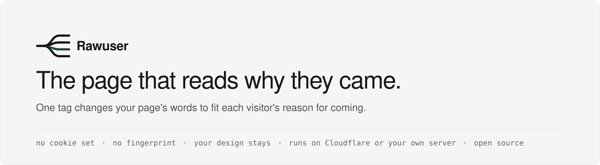
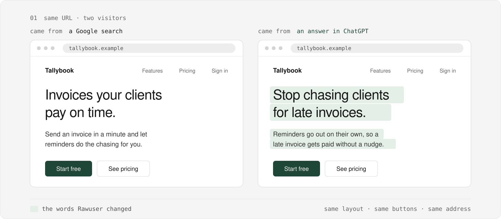
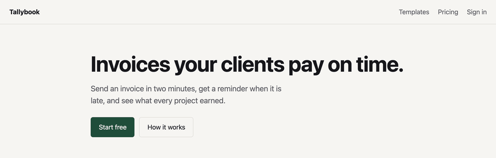
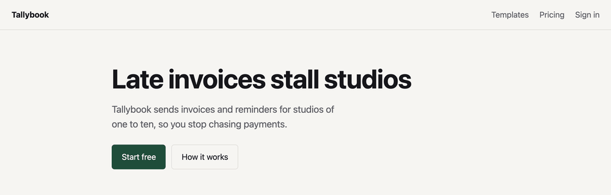
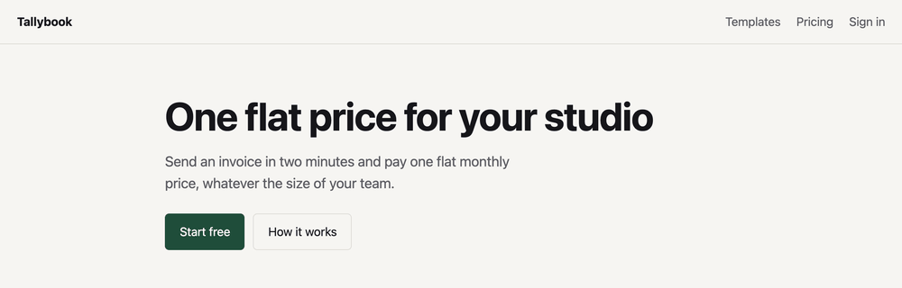
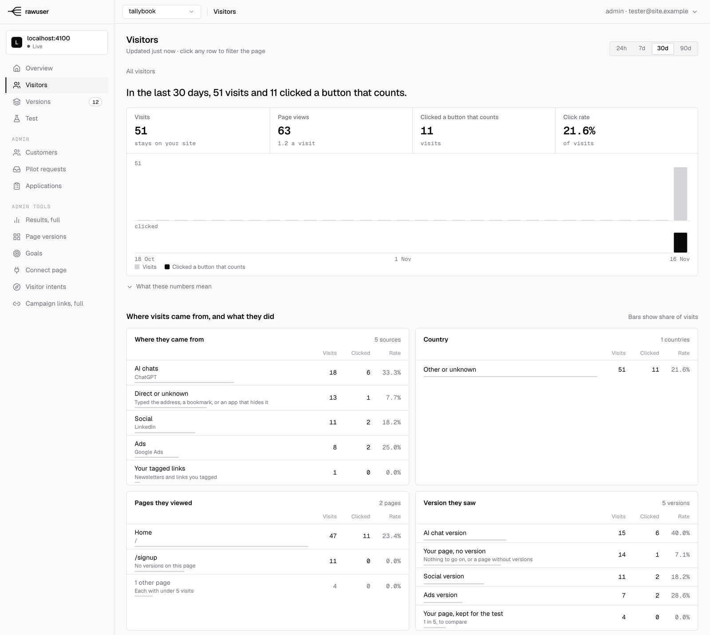
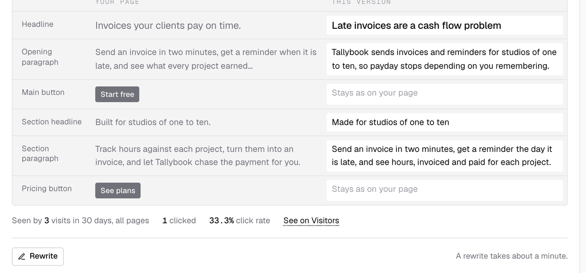
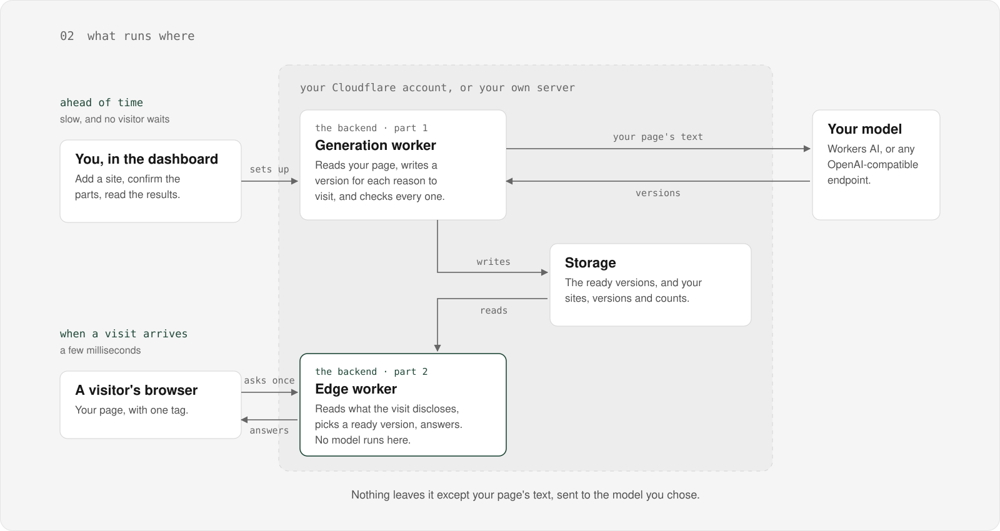

<p align="center">
  <picture>
    <source media="(prefers-color-scheme: dark)" srcset="docs/assets/banner-dark.svg">
    
  </picture>
</p>

<p align="center">
  <a href="#what-it-does">What it does</a> ·
  <a href="#see-it-run">See it run</a> ·
  <a href="#how-it-works">How it works</a> ·
  <a href="#run-it-yourself">Run it yourself</a> ·
  <a href="#put-it-on-your-site">Put it on your site</a> ·
  <a href="#what-it-reads-and-what-it-never-does">Privacy</a> ·
  <a href="#questions">Questions</a>
</p>

## What it does.

Your page says one thing to everyone. But the visitor who asked ChatGPT how
to stop chasing late invoices, the one who searched your name, and the one
who clicked a pricing ad did not come for the same reason.

Rawuser writes your headline and text for each of those reasons ahead of
time, and shows every visitor the one that fits why they came. The address,
the design and the buttons stay exactly as you built them.

<p align="center">
  <picture>
    <source media="(prefers-color-scheme: dark)" srcset="docs/assets/two-visitors-dark.svg">
    
  </picture>
</p>

| You get | You never have to |
|---|---|
| A page that speaks to the reason for each visit | Rebuild, redesign or move your site |
| Versions written and checked before any visitor arrives | Write the versions yourself |
| A count of which versions led to more clicks | Identify, track or follow a visitor |
| Search engines and AI crawlers reading the page as you built it | Set a cookie |

## See it run.

This is one real run of this repository: started on a laptop with
`pnpm server:start`, pointed at a made-up site called Tallybook, with one
model key. Nothing here is drawn.

| The page as built | From an answer in ChatGPT | From a pricing ad |
|---|---|---|
|  |  |  |

| Where the visit came from | The headline it read |
|---|---|
| No signal, or a search crawler | Invoices your clients pay on time. *(the page as built)* |
| An answer in ChatGPT | Late invoices stall studios |
| A pricing ad | One flat price for your studio |
| A post on LinkedIn | Send an invoice in two minutes |

What happened in that run:

- **13 seconds** for the first read: the page's language, six parts to
  rewrite, a brief drafted from the page's own sentences, a first version.
- **30 versions in about two and a half minutes**, none refused.
- **The layout did not move.** Each headline is written in three lengths,
  and the page kept the one that holds its line.
- **The buttons stayed as built**, and a click on "Start free" was counted.

### What you see afterwards.

<p align="center">
  
</p>

- **Where visits came from**, and how many of each clicked: AI chats,
  ads, social, your own tagged links, and those that came with nothing.
- **Which version each visit saw**, with its click rate beside it.
- **A test, if you want one**: 1 visit in 5 keeps your original page, so
  the difference the versions make is measured and not assumed.

<p align="center">
  
</p>

- **Every version beside your own words**, part by part, so you can read
  what any visitor will read.
- **A changed version waits for your OK** before a visitor sees it.

The numbers in these pictures are test visits we made ourselves on the
sample site. They are not anyone's results.

## How it works.

1. **It reads your page once.** You confirm which parts may change: the
   headline, a paragraph, a section heading.
2. **It writes a version for each reason to visit.** A model writes them
   ahead of time, and code checks each one before it is kept: no number you
   never gave, the right language, nothing that breaks your layout.
3. **Each visitor gets theirs.** When a visit arrives, Rawuser reads what
   the visit itself discloses (a campaign tag, the site it came from, an AI
   assistant's own mark, the page opened) and shows the version that fits.

If anything goes wrong, your page wins: a visitor sees it as you built it.

<details>
<summary>For the technical</summary>

<br>

```
writing is offline and slow · choosing is at the edge and fast
```

No model runs while a visitor waits. Versions are written by a background
worker and stored in Workers KV. The visit is answered by a second worker
that classifies the request into two words (why, from where), reads the
matching version from KV and returns it. The script in the page hides only
the parts to be rewritten, keeping their box, writes into the page's own
text nodes, and picks the length that holds each line where it was. With no
answer in 1.5 seconds the parts are shown as built.

More in [docs/how-it-works.md](docs/how-it-works.md).

</details>

## What runs where.

Rawuser has a backend, and it is in this repository. It runs where you
choose: in your own Cloudflare account, or on any machine that runs Node.
Nothing of ours is in the path.

<p align="center">
  <picture>
    <source media="(prefers-color-scheme: dark)" srcset="docs/assets/how-it-runs-dark.svg">
    
  </picture>
</p>

| Part | What it does | Where it runs |
|---|---|---|
| **The tag** | Hides the parts to rewrite, asks once, writes the answer in | The visitor's browser |
| **Edge worker** | Answers every visit: reads the signals, picks a ready version | Cloudflare Workers, or your server |
| **Generation worker** | Reads your page, writes and checks versions, counts results, serves the dashboard | Cloudflare Workers, or your server |
| **Storage** | The ready versions; sites, versions and counts | KV and D1, or SQLite files on your server |
| **Dashboard** | Where you add a site, confirm the parts and read the results | Cloudflare Pages, or your server |
| **The model** | Writes the versions, ahead of time | Any OpenAI-compatible endpoint, or Workers AI |

## Run it yourself.

Two ways, the same code. For both you need Node 22 with pnpm 9 and a
model: any OpenAI-compatible endpoint and its key.

```bash
git clone https://github.com/agshinrajabov/rawuser-oss.git
cd rawuser-oss
pnpm install
```

### On your own server.

Any machine that runs Node, or Docker. One process, and your data in
SQLite files in one folder.

```bash
pnpm server:setup
pnpm server:start
```

`pnpm server:setup` asks for the addresses people will reach it at and
for your model, builds the dashboard for those addresses and makes your
sign-in. With Docker: copy `packages/server/.env.example` to `.env`, fill
it in, and `docker compose up -d`.

Timed on a laptop with Docker, from `git clone` of this repository, on
17 November 2026:

| Step | Time |
|---|---|
| `git clone` | 14 s |
| Build the image | 107 s (91 s with no build cache) |
| Start, until the API and the dashboard answer | 32 s |
| Make your sign-in | 2 s |
| **A running install** | **2 min 36 s** |
| Add a site, open it once, first read, Go live | 95 s |
| From Go live until all 30 versions are written | about 3 min |
| **From the clone to 30 written versions** | **about 7 min** |

The model's speed sets the last two rows.

### On Cloudflare.

Your own Cloudflare account: answered from Cloudflare's edge, and Workers
AI can be the model.

```bash
npx wrangler login
pnpm self-host
```

`pnpm self-host` says what it is about to do and asks before it changes
anything: it makes the storage, deploys the two workers and the dashboard,
makes your sign-in and prints your dashboard's address.
`pnpm self-host --dry-run` changes nothing.

Either way, nothing is sent to us. Your install talks to your own host,
your own site and your model.

<details>
<summary>Your own domains, settings, updating, backups</summary>

<br>

All of it is in [docs/self-hosting.md](docs/self-hosting.md), for both
ways: your own domains, every setting with its default, updating, what
to back up, how to delete data, what differs between the two, and what
the law asks of whoever runs an install.

</details>

## Put it on your site.

Once your dashboard is up:

1. **Sign in and add your site.** One question about what the site is
   about decides how careful Rawuser must be.
2. **Paste one tag** as the first thing in your page's `<head>`. The
   dashboard shows the steps for Webflow, Framer, Wix, Squarespace,
   Shopify, WordPress, Lovable and Next.js. Plain HTML needs only the
   paste.
3. **Open your page once** with the link the dashboard gives you. The parts
   Rawuser found are outlined on your real page. Click to change them.
4. **Check the short brief**: what you sell and who it is for, drafted from
   your own page.
5. **Go live.** The versions are written in the background and each one
   reaches visitors when it is ready.

After that the dashboard shows where visits came from, which version each
saw, and which buttons were clicked. A changed version waits for your OK
before visitors see it.

> [!IMPORTANT]
> Before the tag goes on a site with real visitors, read
> [what the law asks of you](docs/self-hosting.md#what-the-law-asks-of-you).
> In the EU and the UK, load the tag after your consent tool has a yes.

## What it reads, and what it never does.

It reads what a visit discloses: campaign tags, the site or app the visitor
came from, an AI assistant's own mark, the name of an ad platform's click
parameter, the page opened, the language, the country. The whole list, with
what is kept of each, is in [docs/signals.md](docs/signals.md).

Five lines never move, whatever a setting or a customer asks:

| | Never |
|---|---|
| 1 | Fingerprint a visitor |
| 2 | Carry an identity across sites, or set a third-party cookie |
| 3 | Link one visitor across customers |
| 4 | Guess a special category such as health, religion or politics, or sort visitors for prices or eligibility |
| 5 | Sell or share data about a single visitor |

Each line is held by tests in this repository, named in
[docs/privacy-rules.md](docs/privacy-rules.md). A version that crosses one
may not be called Rawuser: [TRADEMARK.md](TRADEMARK.md).

What the tag does keep in a browser, plainly: a random code and two words
in the tab's storage for thirty minutes, to count a visit once and keep its
pages consistent. One optional switch, off in a fresh install, remembers a
returning visitor with a random code in local storage for 13 months.

## Self-hosted or hosted.

| | Run it yourself | [userawuser.com](https://userawuser.com) |
|---|---|---|
| The code | This repository | This repository |
| Who runs and watches it | You | We do |
| Where the data lives | Your Cloudflare account, or your server | Ours |
| The model | Yours | Included |
| What it learns from | Your own sites | Many sites, in totals only |
| Help | Issues here, for bugs | Someone to ask |

## Questions.

<details>
<summary><b>Is this cloaking? Will it hurt my search ranking?</b></summary>

<br>

Search engines and AI crawlers always get the page as you built it, so
what is indexed is what you wrote. Visitors see the same product and the
same facts in different words.

</details>

<details>
<summary><b>Does it slow my page down?</b></summary>

<br>

The tag is about 4 KB and the rest loads beside it, under 15 KB. Your page
paints as usual; only the parts being rewritten wait, and if no answer
comes in 1.5 seconds they are shown as built.

</details>

<details>
<summary><b>What if a version says something wrong?</b></summary>

<br>

Every version is checked by code before it is kept, and one that fails is
never shown. You can read every version in the dashboard, and after your
first go live a changed one waits for your OK.

</details>

<details>
<summary><b>What happens to a visitor who gives no reason?</b></summary>

<br>

A visit with no tag, no referrer and no telling page gets your page as
built. Once there are enough visits to learn from, Rawuser may show such
a visit the version that has worked best for them. A switch in the
dashboard turns that off.

</details>

<details>
<summary><b>What does it cost to run?</b></summary>

<br>

The software is free. You pay for where it runs (Cloudflare, or your own
server) and your model for the versions it writes. Versions are written once,
ahead of time, and not per visit.

</details>

<details>
<summary><b>Can I run it without Cloudflare?</b></summary>

<br>

Yes. `pnpm server:setup` and `pnpm server:start` run the whole of it on
any machine with Node, or in Docker, over SQLite files. What you give up:
a visit is answered from where your server is and not from an edge near
the visitor, the visitor's country is known only if a proxy in front of
you says it, and a page that is built in the browser is read through a
link you open yourself.

</details>

<details>
<summary><b>Can I use parts of it without the rest?</b></summary>

<br>

Yes. [`packages/signals`](packages/signals) tells where a visit came
from, and [`packages/intent`](packages/intent) turns that into a reason.
Both are MIT and have no dependency. They are not on npm yet: each README
says how to build it from this repository.

</details>

## In this repository.

| Folder | What | Licence |
|---|---|---|
| `packages/snippet` | The tag that runs on a site | MIT |
| `packages/shared` | Signal tables, the classifier, shared types | MIT |
| `packages/signals` | Where a visit came from, as its own package | MIT |
| `packages/intent` | From signals to a reason, as its own package | MIT |
| `packages/edge` | The worker that answers visits | AGPL-3.0 |
| `packages/generation` | The worker that writes versions and serves the dashboard | AGPL-3.0 |
| `packages/dashboard` | The dashboard | AGPL-3.0 |
| `migrations` | The database | AGPL-3.0 |
| `docs` | How it works, signals, self-hosting, privacy rules, decisions, research | |

What runs on someone else's site is MIT, so embedding the tag puts no duty
on that site. What runs as a service is AGPL, version 3 only: if you run a
changed Rawuser for other people, you publish your changes.
[NOTICE.md](NOTICE.md) has the details.

## Working on it.

```bash
pnpm install
pnpm typecheck
pnpm test
pnpm lint
```

The tests need no account and no network.
[CONTRIBUTING.md](CONTRIBUTING.md) says how a change lands and which lines
it may not cross. For a vulnerability, write to the address in
[SECURITY.md](SECURITY.md) and do not open an issue.

## Read more.

| | |
|---|---|
| [How it works](docs/how-it-works.md) | From setup to a visit, part by part |
| [Signals](docs/signals.md) | What is read, what is kept, what the law looks at |
| [Self-hosting](docs/self-hosting.md) | Install, settings, domains, and your duties |
| [Text for your privacy notice](docs/privacy-notice.md) | The words to tell your visitors |
| [Privacy rules](docs/privacy-rules.md) | The five lines and the tests that hold them |
| [Decisions](docs/decisions/README.md) | Why it is built this way |
| [Research](docs/research/) | What we measured about where visits come from |

<p align="center"><sub>Copyright (c) 2026 PixelHurts, LLC, doing business as Rawuser.</sub></p>
